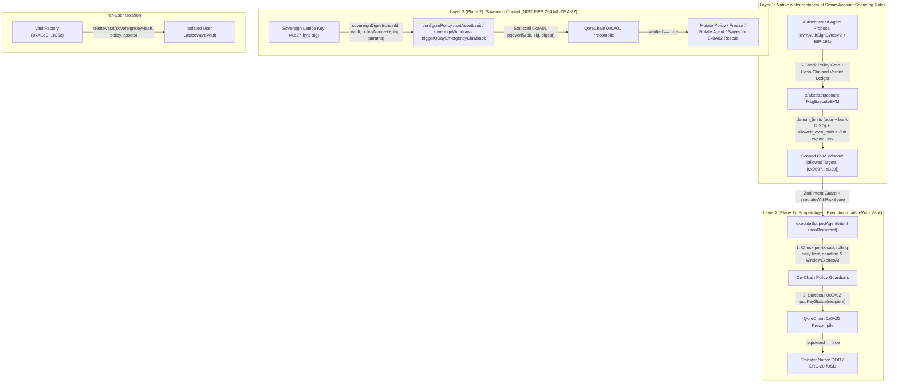

# LatticeWard

[](https://build.qorechain.io/p/latticeward)

**Post-quantum spend-governance & Q-Day immunity engine for autonomous AI agents on QoreChain.**

Built for the QoreChain Developer Fest **"Build Before Q-Day"** (Post-Quantum AI Agents track). Target network: `qorechain-diana` (EVM Chain ID `9800`).

---

## 1. Architecture & 3-Layer Post-Quantum Defense Model

AI agents need hot `secp256k1` keys to sign payouts without human popups. Today a prompt injection or server breach can leak that key; on Q-Day, Shor's algorithm derives classical private keys directly from public keys on-chain. LatticeWard assumes **every classical key will be compromised** and enforces a **3-Layer Defense-in-Depth Architecture** across QoreChain's native Cosmos modules and EVM precompiles:



| Layer / Plane | Key & Authority | Allowed Actions & Limits | On-Chain Enforcement |
|---|---|---|---|
| **Layer 1: Native `x/abstractaccount` & Scoped EVM Window** | Linked `secp256k1` authenticator (`0xc403...DE04`) under hybrid `eth_secp256k1 + ML-DSA-87` owner authority | Native `denom_limits` for `uqor` (`100,000 uqor/tx`, `300,000 uqor/day`) and bank `fUSD` (`erc20:0x9714...63CA`: `1,000,000/tx`, `3,000,000/day`), 30-day `expiry_unix` (through Dec 15 judging), deny-by-default `allowed_evm_calls: [0x9697...aB29]`, authenticated `evmAuthSignBytesV2` + `MsgOpenEVMWindow` | QoreChain `x/abstractaccount` (`MsgUpdateSpendingRules`, `MsgRegisterAuthenticator`, `MsgExecuteEVM`, `MsgRevokeAuthenticator`) + `x/pqc` (`MsgOpenEVMWindow`) |
| **Layer 2 (Plane 1): `LatticeWardVault` Execution** | Disposable `secp256k1` `agentKey` | Pay out inside a scoped window: per-asset `maxTxValue` & rolling `epochLimit` for both native `QOR` (`0.1 QOR/tx`, `0.3 QOR/day`) and ERC-20 `fUSD` (`1.0 fUSD/tx`, `3.0 fUSD/day`), `windowExpiresAt`, per-intent `deadline`, asset allowlist (`assetLimits`), replay-protected intents (`usedIntents`), recipient must pass `QorePQC.isRegistered` / `IPQCKeyStatus(0x0000000000000000000000000000000000000a02).pqcKeyStatus` (`0x0A02`) | `LatticeWardVault.executeScopedAgentIntent` (`nonReentrant`) |
| **Layer 3 (Plane 2): `LatticeWardVault` Sovereign Control** | `ML-DSA-87` (FIPS 204) | `configurePolicy`, `setAssetLimit`, `sovereignWithdraw`, `triggerQDayEmergencyClawback` (`emergencyClawback`), `rotateSovereignKey` | `QorePQC.verify` / `IPQCVerify(0x0000000000000000000000000000000000000a01).pqcVerify` (`0x0A01`) over `sovereignDigest` bound to `block.chainid` + `address(this)` + `policyNonce++` + `tag` + `keccak256(params)` |

The vault has **no `ecrecover` and no `onlyOwner`**. `msg.sender` carries zero administrative authority, so a leaked classical key cannot escalate privileges, alter limits, or drain the treasury.

---

## 2. Repository Layout

```text
contracts/            LatticeWardVault.sol, VaultFactory.sol, libraries/QorePQC.sol, interfaces/IQorePrecompiles.sol
contracts/test/       LatticeWard.t.sol, LatticeWardVault.t.sol, LatticeWardVault.invariant.t.sol, VaultFactory.t.sol
script/               Deploy.s.sol, DeployFactory.s.sol
src/                  abstractAccount.ts (x/abstractaccount spending rules & MsgExecuteEVM), authenticatedAgent.ts (EIP-191 signed intent proposals & hash-chained verdict ledger)
packages/agent-mcp/   abi.ts, config.ts, schema.ts (Zod), pqc.ts, precompiles.ts, preflight.ts, agent.ts, drill.ts, sovereign.ts, mcp-server.ts
packages/web/         Vite + React + TypeScript frontend (0x0A02 Quantum Status Gate, Live Telemetry, Layer 1 x/abstractaccount & Verdict Ledger, Guardrail Configurator, Agent Executor, Kill-Switch)
packages/relayer/     Stateless serverless relayer + CORS evm-window proxy (Vercel)
scripts/              setup-abstract-account.ts, verify-defense.ts, probe-precompiles.ts, check-window.ts, convert-fusd.ts, fund-vault.ts, gen-sovereign-key.ts, sovereign-cli.ts, verify-qday.ts
audits/               onchain-proof.json, verdict-ledger.jsonl, qorescan_stage1.json (@qorechain/qorescan static analysis report)
docs:                 THREAT_MODEL.md, AI_USAGE.md, SUBMISSION_COPY.md, DRILL_RUNBOOK.md, USABILITY_TEST.md, LICENSE
```

---

## 3. Quickstart & Verification Commands

```bash
npm install
npm --prefix packages/web install

# 1. Smart Contract Suite (39/39 unit, fuzz, hardening & invariant tests)
forge test -vv

# 2. TypeScript & Production Web Build
npm run typecheck
npm run build

# 3. Live Testnet Precompile Probe & Q-Day Breach Drill (qorechain-diana, Chain ID 9800)
cp .env.example .env              # populate testnet RPC & keys
npm run setup:aa                  # register x/abstractaccount spending rules, link authenticator & open scoped EVM window
npm run verify:defense            # execute 3-layer defense verification (writes audits/onchain-proof.json & audits/verdict-ledger.jsonl)
npm run probe                     # verify live 0x0A01 & 0x0A02 precompile ABIs
npm run check:windows             # inspect PQC registration & EVM window status
npm run verify:qday               # run 8-scenario live Q-Day breach drill
npm run mcp                       # start LatticeWard 5-tool MCP server over stdio
npm run mcp:qorechain             # start @qorechain/mcp (qorechain-mcp) server (configured in .mcp.json & .cursor/mcp.json)
npm run qore:status               # query qorechain-diana via qore CLI (@qorechain/qore-cli)
npm run qore:inspect              # inspect PQC registration status via qore CLI

# 4. Run Local Web UI
cd packages/web && npm run dev    # http://127.0.0.1:5173
```

---

## 4. Live Testnet Deployment (`qorechain-diana`, Chain ID `9800`)

- **Hardened `LatticeWardVault` (`VAULT_ADDRESS`):** `0x9697a96058555b3A0C50b2338440C84B927caB29` (`qor1j6t6jczc24dn5rzskgecgsxgfwf8e2efp7z6qp`)
  - Deploy Tx: [`0xce42a4cd136064c000170a7f2d03193b1fe1f3e02e60a2094ffeb10dde6c7e84`](https://explore.qore.network/tx/0xce42a4cd136064c000170a7f2d03193b1fe1f3e02e60a2094ffeb10dde6c7e84)
  - Vault QOR Funding Tx (`1.0 QOR`): [`0x62106213413a97a740c39235390fcfbcf2e3e3502dfe545c96a4b9c8e02ee4c5`](https://explore.qore.network/tx/0x62106213413a97a740c39235390fcfbcf2e3e3502dfe545c96a4b9c8e02ee4c5)
  - Drill Account Normal Vault Deposit Tx (`0.01 QOR` from `0xD689...5aae`): [`0xe25725c68d99c780dd997b0f59792eb50061a4eb7c64c23e30437e7f9d0a9e53`](https://explore.qore.network/tx/0xe25725c68d99c780dd997b0f59792eb50061a4eb7c64c23e30437e7f9d0a9e53) (Cosmos hash: `56B44D5F648C3846239F35A09B6BEE6F8359CAA7CE6F8DA20957E6531BFD3F16`; Hybrid `MsgOpenEVMWindow`: `A5F5F2818ECF5EB26ED2185227AEBD5A62AED136FE75AAD330A31EAAEAF5934A`)
  - Hybrid `MsgConvertCoin` Txs (Cosmos lane, `eth_secp256k1` + `ML-DSA-87`):
    - `1.0 fUSD` (Block `10156333`): `749C8D5FC198C51DF517F43479E3AFD3BE09AEFE50CC9A83EF5F528AA86FF303`
    - `49.0 fUSD` (Block `10156945`): `244983ED2FF685777D3494003FBB69A018EABB37C193A3737AC3AEB62E922F01`
  - Vault ERC-20 `fUSD` Funding Tx (`50.0 fUSD`): [`0x4df234b8fa8a22118423433839cd215c4116c4c06df2654f87cb89cbf07c2ad2`](https://explore.qore.network/tx/0x4df234b8fa8a22118423433839cd215c4116c4c06df2654f87cb89cbf07c2ad2)
- **`VaultFactory` (per-user vault deployer):** `0xAEdE5a3B09c9BDC749297C39826C6DDdaF311C5c`
  - Deploy Tx: [`0xea6b9acd6908ea7294e57087ba6448e340685509525f50b49cdc283d3ed594ff`](https://explore.qore.network/tx/0xea6b9acd6908ea7294e57087ba6448e340685509525f50b49cdc283d3ed594ff)
- **Sovereign ML-DSA-87 Key Hash (`sovereignKeyHash`):** `0xfc4c13af8aac8233f2566485d7ca4ba7ef53db50c07aebad3630cf2058178d23`
- **Registered Drill Account & PQC Recipient (`0x0A02` registered):** `0xD6891e4Ef67be07b5DE9703Dcc4cf36eF4D15aae` (`qor166y3unhk00s8kh0fwq7ucn8ndm6dzk4w0gq3kx`)
- **Scoped Agent (disposable hot key):** `0xc40352672Ac28fD9DE498AbE2c3CedF9367FDE04` (`qor1csp4yee2c28anhjf32lzc08dlym8lhsydmhj6l`)
- **Deployer / Submitter:** `0x480261F742b3CfA5f1659da6FAd089BDB6CFD0B3` (`qor1fqpxra6zk086tut9nkn045yfhkmvl59nlnegea`)
- **fUSD (FestUSD, 6 decimals):** `0x97143B771D34ddb9130b807b135Ae675A5a963CA`

### Live Q-Day Breach Drill Proof (`8/8 PASS`)

| Check | Scenario | Expected / Observed | Explorer Link |
|---|---|---|---|
| **1** | Valid agent payout inside scoped window | `success` | [`0xf176d242...8e69bfcc`](https://explore.qore.network/tx/0xf176d24256d812af43b035a4eb4655156a3aadddcbd7f0332a9e170d8e69bfcc) |
| **2** | Prompt-injected over-spend (10x per-tx cap) | `revert ExceedsScopedMaxTxValue` | [`0xc1c7521c...8ab5d654`](https://explore.qore.network/tx/0xc1c7521c78a041ff91a0cdda0347cafb1568b1606f34d40a287b28a68ab5d654) |
| **3** | Payout to non-PQC burner address (`0x0A02`) | `revert RecipientNotQuantumSafe` | [`0xaee3adac...59e8bf33`](https://explore.qore.network/tx/0xaee3adacd0ae5f5e530cb39552f3a820ef397318ae6af040585e546959e8bf33) |
| **4a** | Leaked ECDSA key: hijack policy to `'unlimited'` (`0x0A01`) | `revert InvalidMLDSASignature` | [`0xc5ea3799...56f64a52`](https://explore.qore.network/tx/0xc5ea37991d81a18b2af9b25ab59247df9abd3d5a33bab6d923ccbccc56f64a52) |
| **4b** | Leaked ECDSA key: `sovereignWithdraw` entire vault (`0x0A01`) | `revert InvalidMLDSASignature` | [`0xd475f3fc...7f368f6b`](https://explore.qore.network/tx/0xd475f3fce24190e0bd949e90058a98f7b7c4878300bd8bc23f5791d27f368f6b) |
| **5** | Replay of an executed intent | `revert IntentAlreadyUsed` | `staticCall verified (revert IntentAlreadyUsed)` |
| **6a** | ML-DSA-87 emergency clawback (`triggerQDayEmergencyClawback`): revoke compromised key + freeze | `frozen=true rotated=true oldKeyBlocked=true` | [`0x16dac299...b5edf9e0`](https://explore.qore.network/tx/0x16dac29907d06ffbd1567392e0ab9c98e1d4f6661afa537a0470ed56b5edf9e0) |
| **6b** | ML-DSA-87 recovery: unfreeze + restore agent | `frozen=false` | [`0x8c53a3db...b74ea7da`](https://explore.qore.network/tx/0x8c53a3db12e00cc51ed291e188c64b0f2b00d1a5f772bee757caa32fb74ea7da) |

### Live `x/abstractaccount` Smart-Account Spending Rules & Defense Proof (`npm run verify:defense`, `allPassed: true`)

Full verbatim receipts and hash-chained policy verdicts are committed in [`audits/onchain-proof.json`](./audits/onchain-proof.json) and [`audits/verdict-ledger.jsonl`](./audits/verdict-ledger.jsonl):

| Step / Test | Protocol Action | On-Chain Result | Block / Cosmos Tx Hash |
|---|---|---|---|
| **Setup (`DEPLOYER`)** | `MsgUpdateSpendingRules` (`denom_limits` for `uqor` (`100,000/tx, 300,000/day`) & bank `fUSD` (`erc20:0x9714...63CA`: `1,000,000/tx, 3,000,000/day`), `allowed_evm_calls: [0x9697...aB29]`) + `MsgRegisterAuthenticator` (`secp256k1`, 30-day `expiry_unix`) + `MsgOpenEVMWindow` (`17,280` blocks) | `code: 0` | Block `10418265` · [`A374DDC5...9388`](https://explore.qore.network/tx/A374DDC5C787BFAD914F9870F9318DB321C8580EBCC8CA0715505B239D9A9388) |
| **Retire Drill Account (`DRILL_ACCOUNT`)** | `MsgUpdateSpendingRules` (locked to `1 uqor`) + `MsgCloseEVMWindow` on retired public drill account `qor166y3unhk00s8kh0fwq7ucn8ndm6dzk4w0gq3kx` | `code: 0` (`window.live=false`) | Block `10418268` · [`023BB99C...57D4`](https://explore.qore.network/tx/023BB99C0C6839A32C0A34E04B5A7E70B426E522358189878F92800E6DDE57D4) |
| **Test 1 (In-Policy)** | Authenticated agent proposal (`evmAuthSignBytesV2` + EIP-191) -> `MsgExecuteEVM` -> `LatticeWardVault.executeScopedAgentIntent` (`0.001 QOR`) | `ALLOW` (`entryHash: 0x19b2be9a...02954`) | Block `10418271` · [`D3AB9E1E...7E7A`](https://explore.qore.network/tx/D3AB9E1E52052BF0AB2D5A559A2EC9AB40D3563F05B5A8B867404D79D6D17E7A) |
| **Test 2a (Value Cap Refusal)** | Over-spend proposal (`1.0 QOR > 0.1 QOR` per-tx cap) | `DENY` (`entryHash: 0x8babab61...c6d1`) + `ExceedsScopedMaxTxValue` | Blocked fail-closed & reverted on-chain |
| **Test 2b (Duration Refusal)** | Expired intent deadline / window | `DENY` (`entryHash: 0x95b9f539...d5a3`) + `IntentExpired` | Blocked fail-closed & reverted on-chain |
| **Test 2c (Target & `0x0A02` Refusal)** | Unallowlisted target & non-PQC recipient (`0x0000...dEaD`) | `DENY` (`entryHash: 0x5d8055bf...83fa`) + `RecipientNotQuantumSafe` | Block `10418274` · [`D3E87638...BA65`](https://explore.qore.network/tx/D3E876383E986279BB7AA2533E36FAC9ACB767C94F33D93D490DDD4CAD8EBA65) |
| **Test 3 (Revoke & Restore)** | Owner revokes authenticator (`MsgRevokeAuthenticator`), proves post-revocation `MsgExecuteEVM` fails (`linked key is unbound or revoked`), and restores active 30-day state | `PASS` | Revoke: [`28084ACC...1D11`](https://explore.qore.network/tx/28084ACC143F4E20BAF992CD68D3AB2E31A066944073F7BE1581F740BB361D11) · Blocked Tx: `3FDB9D39...CA80` · Restore: [`C5482CDF...9329`](https://explore.qore.network/tx/C5482CDF1F73675F30A683B738C111C105FD6F3856B812E4C529C31A8E349329) |

### Agent-Pays-API (`402` Invoice Flow), Off-Chain Payee Gate & Web Session Panel

To demonstrate **agents autonomously paying from the vault** while keeping on-chain enforcement separate from off-chain pre-signing controls:

- **Paid API (`examples/agent-pays-api/server.ts`, `npm run api:paid`):** `GET /data` returns `402 Payment Required` with `{invoiceId, amount, asset, recipient, vault, chainId}` pointing to the `0x0A02`-registered recipient `0xD689...5aae`. `GET /data?invoice=<id>` verifies `AuthenticatedAgentIntentExecuted` on-chain (`intentId == keccak256(invoiceId)`), returns the data (`200`), and rejects invoice reuse (`409 Conflict`).
- **Agent Client & MCP Tool (`scripts/agent-buys-data.ts`, `npm run agent:buy`, MCP `latticeward_pay_invoice`):** Runs the full `402` → signed proposal → off-chain policy gate → vault settlement (`intentId = keccak256(invoiceId)`, `rationaleHash = keccak256(description)`) → retry flow.
- **Off-Chain Payee Policy Gate (`config/payee-policy.json`, `src/policyGate.ts`):** Enforces a payee allowlist and per-payee tx/daily caps **before signing**, logging denials to `audits/verdict-ledger.jsonl` with `enforcementLayer: "off-chain gate"` (e.g., prompt-injection denial entry `#8`, `0xf14c4c44...f89eb`) — distinct from on-chain reverts (`ExceedsScopedMaxTxValue`, `RecipientNotQuantumSafe`). Supports `PREFLIGHT_MODE=required|advisory` (default `required`; `advisory` logs `preflight_unavailable` and displays a visible UI badge).
- **Web App Session Panel (`packages/web/src/components/SessionPanel.tsx`):** Lets owners **Start 6h Session** (`MsgOpenEVMWindow`), inspect remaining blocks/txs/budget, **Stop Session** (`MsgCloseEVMWindow`), and view recent agent payments & invoice IDs (*sessions last about 6 hours*).
- **Automated Verification (`npm run test:agent-pays`):** `7/7` E2E tests passing (402 invoice, pre-pay 402, off-chain allow, over-cap deny, prompt-injection deny + ledger record, 200 post-pay, 409 replay rejection).

---

## 5. Credits & Attribution

- **QoreChain Kits & Precompiles:**
  - `@qorechain/sdk` (`EthNativeSigner`, `openEvmWindowMsg`, `simulateWithRiskScore`, `deriveUnifiedAccount`)
  - `@qorechain/qorex-types` (EIP-6963 QoreX wallet discovery & `window.qorex.native` capabilities)
  - `@qorechain/qorescan` (Solidity post-quantum static analysis & cryptographic bill of materials)
  - Precompiles `0x0A01` (`pqcVerify`, ML-DSA-87 / FIPS 204) and `0x0A02` (`pqcKeyStatus`)
- **Libraries & Tooling:**
  - `@openzeppelin/contracts` (`ReentrancyGuard`)
  - `@noble/post-quantum` (FIPS 204 `ml_dsa87`)
  - `@modelcontextprotocol/sdk` (5-tool MCP server)
  - Foundry (`forge-std`)

## License

[MIT](./LICENSE)
