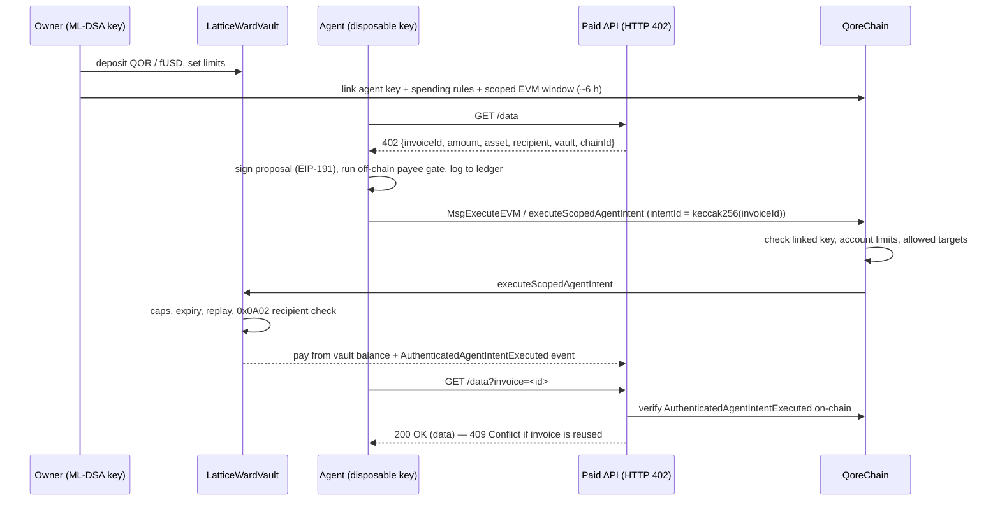

# LatticeWard

[](https://build.qorechain.io/p/latticeward)

**A treasury vault for AI agents that stays safe when classical keys leak, today or on Q-Day.**

Built for the QoreChain Developer Fest, *Build Before Q-Day* (category: Post-Quantum AI Agents).  
Network: QoreChain Diana testnet (`qorechain-diana`, EVM chain ID `9800`). **Testnet prototype, unaudited. Do not use with real funds.**

| | |
|---|---|
| Live app | https://latticeward-protocol.onrender.com/ |
| Demo video | https://youtu.be/9QmegHHu8jc |
| Submission page | https://build.qorechain.io/p/latticeward |
| Vault | [`0x9697a96058555b3A0C50b2338440C84B927caB29`](https://explore.qore.network/address/0x9697a96058555b3A0C50b2338440C84B927caB29) (`qor1j6t6jczc24dn5rzskgecgsxgfwf8e2efp7z6qp`) |
| Vault factory | [`0xAEdE5a3B09c9BDC749297C39826C6DDdaF311C5c`](https://explore.qore.network/address/0xAEdE5a3B09c9BDC749297C39826C6DDdaF311C5c) |
| Licence | MIT |

## The problem

An AI agent that moves money needs a hot signing key (`secp256k1`). A prompt injection or a server breach can leak it today. On Q-Day, Shor's algorithm can derive classical private keys from public keys on-chain. A vault that relies on `ecrecover` or `onlyOwner` for admin control loses everything in either case.

## The idea: assume every classical key will leak

LatticeWard splits authority across three layers.

| Layer | What it does | Enforced by |
|---|---|---|
| **1. Protocol rules** | The owner links the agent's key as an authenticator with limits: per transaction and per day for QOR and bank-coin fUSD, a deny-by-default list of allowed EVM call targets (the vault only), and a 30-day expiry. The agent's EVM window is scoped to the vault. | QoreChain `x/abstractaccount` and `x/pqc` |
| **2. The vault** | The agent key can only call `executeScopedAgentIntent`: per-asset caps (QOR and ERC-20 fUSD), a rolling daily cap, an expiry window, an asset allowlist, replay-protected intents, and a recipient firewall that calls `pqcKeyStatus` (`0x0A02`) and refuses any recipient without a registered ML-DSA-87 key. | `LatticeWardVault.sol` |
| **3. Sovereign control** | Every admin action (`configurePolicy`, `setAssetLimit`, `sovereignWithdraw`, `triggerQDayEmergencyClawback`, `emergencyClawback`, `rotateSovereignKey`) needs a 4,627-byte ML-DSA-87 signature verified on-chain by `pqcVerify` (`0x0A01`). The signed digest is bound to the chain ID, the vault address, a nonce (`policyNonce++`) and the exact parameters, so each signature works once. | `LatticeWardVault.sol` + `QorePQC.sol` |

The contract has **no `ecrecover` and no `onlyOwner`**. `msg.sender` carries no admin authority, so a stolen classical key cannot administer the vault.

## How an agent pays from the vault



- **Paid API demo (`examples/agent-pays-api`):** `GET /data` returns `402 Payment Required` with an invoice pointing to the `0x0A02`-registered recipient `0xD689...5aae`. After vault payment (`intentId = keccak256(invoiceId)`), `GET /data?invoice=<id>` verifies the on-chain `AuthenticatedAgentIntentExecuted` event, returns `200`, and rejects invoice reuse with `409 Conflict`.
- **Agent side & off-chain payee gate:** a fail-closed Zod schema lets the agent express only *execute within scope* or *reject*. Before signing, `src/policyGate.ts` enforces a payee allowlist and per-payee tx/daily caps from [`config/payee-policy.json`](config/payee-policy.json), recording every decision in a SHA-256 hash-chained ledger ([`audits/verdict-ledger.jsonl`](audits/verdict-ledger.jsonl)) with `enforcementLayer: "off-chain gate"` separate from on-chain results.
- **MCP server:** six `latticeward_*` tools for Claude Desktop, Cursor and similar clients (including `latticeward_pay_invoice`), with a 1-click **Connect an AI Agent** config drawer in the web app.
- **Pre-flight (`PREFLIGHT_MODE`):** wired to `simulateWithRiskScore` with `PREFLIGHT_MODE=required|advisory` (default `required`, fail-closed). Because the public testnet endpoint does not serve `simulateWithRiskScore` yet, `advisory` mode explicitly logs `preflight_unavailable` in the verdict ledger and displays a visible warning badge in the UI (never silent).
- **Sessions:** the web app includes a **Session Window & Agent Payments** panel (**Start 6h Session**, remaining blocks/txs/budget, **Stop Session**, and recent agent payments with invoice IDs). Sessions last about 6 hours (`17,280` blocks max on testnet), then the owner reopens one.
- **If the agent is compromised:** it can do what its limits allow until the session ends or the owner freezes the vault. It cannot change a rule or withdraw the balance.

## Proof on testnet

### Vault drill (`npm run verify:qday`): 8 of 8 checks passed

| # | Scenario | Result | Tx |
|---|---|---|---|
| 1 | Valid agent payout inside limits | success | [`0xf176d242…`](https://explore.qore.network/tx/0xf176d24256d812af43b035a4eb4655156a3aadddcbd7f0332a9e170d8e69bfcc) |
| 2 | Prompt-injected over-spend (10x limit) | `ExceedsScopedMaxTxValue` | [`0xc1c7521c…`](https://explore.qore.network/tx/0xc1c7521c78a041ff91a0cdda0347cafb1568b1606f34d40a287b28a68ab5d654) |
| 3 | Pay a non-quantum-safe address | `RecipientNotQuantumSafe` | [`0xaee3adac…`](https://explore.qore.network/tx/0xaee3adacd0ae5f5e530cb39552f3a820ef397318ae6af040585e546959e8bf33) |
| 4a | Leaked classical key hijacks the policy | `InvalidMLDSASignature` | [`0xc5ea3799…`](https://explore.qore.network/tx/0xc5ea37991d81a18b2af9b25ab59247df9abd3d5a33bab6d923ccbccc56f64a52) |
| 4b | Leaked classical key drains the vault | `InvalidMLDSASignature` | [`0xd475f3fc…`](https://explore.qore.network/tx/0xd475f3fce24190e0bd949e90058a98f7b7c4878300bd8bc23f5791d27f368f6b) |
| 5 | Replay an executed intent | `IntentAlreadyUsed` | verified by simulation (no tx) |
| 6a | ML-DSA-87 emergency clawback: key revoked, vault frozen | frozen, rotated | [`0x16dac299…`](https://explore.qore.network/tx/0x16dac29907d06ffbd1567392e0ab9c98e1d4f6661afa537a0470ed56b5edf9e0) |
| 6b | ML-DSA-87 recovery | unfrozen | [`0x8c53a3db…`](https://explore.qore.network/tx/0x8c53a3db12e00cc51ed291e188c64b0f2b00d1a5f772bee757caa32fb74ea7da) |

The vault also holds 50 fUSD (ERC-20), funded by [`0x4df234b8…`](https://explore.qore.network/tx/0x4df234b8fa8a22118423433839cd215c4116c4c06df2654f87cb89cbf07c2ad2) after converting the faucet's bank coin with hybrid-signed `MsgConvertCoin`.

### Protocol layer (`npm run verify:defense`)

Live in-policy execution, revoke, a blocked attempt after revoking (`linked key is unbound or revoked`), and restore. Verified on-chain transactions:

- Dual `denom_limits` (`uqor` + bank `fUSD`), target allowlist & 30-day authenticator setup: [`A374DDC5…`](https://explore.qore.network/tx/A374DDC5C787BFAD914F9870F9318DB321C8580EBCC8CA0715505B239D9A9388) (Block `10418265`)
- Retired drill account window closed: [`023BB99C…`](https://explore.qore.network/tx/023BB99C0C6839A32C0A34E04B5A7E70B426E522358189878F92800E6DDE57D4) (Block `10418268`)
- In-policy authenticated `MsgExecuteEVM` into vault: [`D3AB9E1E…`](https://explore.qore.network/tx/D3AB9E1E52052BF0AB2D5A559A2EC9AB40D3563F05B5A8B867404D79D6D17E7A) (Block `10418271`)
- Out-of-policy target & `0x0A02` refusal: [`D3E87638…`](https://explore.qore.network/tx/D3E876383E986279BB7AA2533E36FAC9ACB767C94F33D93D490DDD4CAD8EBA65) (Block `10418274`)
- Authenticator revoke & 30-day restore: [`28084ACC…`](https://explore.qore.network/tx/28084ACC143F4E20BAF992CD68D3AB2E31A066944073F7BE1581F740BB361D11) / [`C5482CDF…`](https://explore.qore.network/tx/C5482CDF1F73675F30A683B738C111C105FD6F3856B812E4C529C31A8E349329)

All results and hashes are saved in [`audits/onchain-proof.json`](audits/onchain-proof.json). Off-chain policy-gate denials (per-payee caps, non-allowlisted prompt-injection target entry `#8` `0xf14c4c44…f89eb`, expiry) are recorded separately as `enforcementLayer: "off-chain gate"` in [`audits/verdict-ledger.jsonl`](audits/verdict-ledger.jsonl) with `txHash: null`. Results enforced on-chain carry a transaction hash.

### Tests

- **Foundry (`forge test`):** `39/39` unit, fuzz, and invariant tests passing (including 256,000 randomized calls from a simulated classical-key attacker who can never move funds or mutate `policyNonce`).
- **Paid API & off-chain gate (`npm run test:agent-pays`):** `7/7` E2E tests passing (`402` invoice, pre-pay `402`, allowlisted payee `ALLOW`, over-payee-cap `DENY`, prompt-injected non-allowlisted/non-PQ `DENY` logged to ledger, post-pay `200` with `intentId` binding, and `409` invoice reuse rejection).
- **Static analysis (`@qorechain/qorescan`):** [`audits/qorescan_stage1.json`](audits/qorescan_stage1.json).

## Try it in 2 minutes (no wallet needed)

1. Open the [live app](https://latticeward-protocol.onrender.com/), click **Open App**, and select **Preview Live Vault (Read-Only)**: live balances, daily caps, `0x0A02` firewall, and the **Session Window & Agent Payments** panel read straight from testnet.
2. Under **Test or Run an Agent Payment**, click *Valid Payout*, *Try Over-Spend*, and *Unprotected Wallet* → **Test Against Policy**. These are read-only `eth_call`s against the live vault.
3. Open **Attack Lab → Run 4 Live Attack Simulations**: over-spend, non-quantum-safe recipient, and two leaked-key attacks. The error names come from the chain.
4. Expand **Connect an AI Agent (MCP)** or **Protocol Proofs**, or open any transaction above on QoreScan.

## Run it yourself

```bash
npm install
forge install foundry-rs/forge-std
forge test -vv                          # 39 contract unit, fuzz & invariant tests
cp .env.example .env                    # testnet keys only; never reuse a key that held real funds
npm run probe                           # confirm the 0x0A01 / 0x0A02 ABI on the live chain
npm run gen:sovereign                   # dedicated ML-DSA-87 keypair
npm run verify:qday                     # live vault drill (briefly freezes then restores the vault)
npm run setup:aa                        # x/abstractaccount rules, authenticator, scoped window
npm run verify:defense                  # protocol-layer defense proof
npm run check:windows                   # key registration and EVM window status
npm run test:agent-pays                 # 7/7 E2E tests for 402 paid API + off-chain payee gate
npm run api:paid                        # start paid 402 API on http://0.0.0.0:4020
npm run agent:buy                       # run agent 402 -> vault payment -> retry + attack demo
npm run mcp                             # 6-tool MCP server over stdio
npm run dev --prefix packages/web       # web app on http://127.0.0.1:5173
```

Every EVM sender on QoreChain needs a registered ML-DSA-87 key and an open EVM window. Windows last at most `17,280` blocks (about 6 hours on testnet), so reopen one before testing.

## Repository layout

```text
contracts/               LatticeWardVault, VaultFactory, QorePQC library, tests and mocks
config/                  payee-policy.json (off-chain payee allowlist and per-payee caps)
examples/agent-pays-api/ HTTP 402 paid data API verifying on-chain vault settlement events
script/                  Foundry deploy scripts
src/                     abstractAccount.ts, authenticatedAgent.ts, policyGate.ts
packages/agent-mcp/      Zod schema, pre-flight, agent pipeline, drill, 6-tool MCP server
packages/web/            web app (Vite, React, TypeScript)
packages/relayer/        optional stateless relayer for user-signed freeze / policy transactions
scripts/                 probe, key generation, drills, window checks, fUSD conversion, agent-buys-data
audits/                  QoreScan output, on-chain proof, hash-chained verdict ledger
```

## What we found along the way

- The `0x0A01` precompile on the live chain takes its arguments in the order `(publicKey, signature, message)`, not `(publicKey, message, signature)`. We found this by probing the chain and aligned the contract and tests.

## Honest limits

- Testnet prototype, unaudited.
- QoreX cannot sign arbitrary ML-DSA messages yet, so the owner's admin signatures come from an encrypted browser key (WebCrypto PBKDF2 + AES-256-GCM in IndexedDB, with a mandatory `.lwkey.json` backup) or a local key file. Losing that key means losing admin on that vault.
- The agent runs only inside an EVM window (about 6 hours), then the owner must reopen one.
- `simulateWithRiskScore` is not served on the public testnet endpoint yet, so `PREFLIGHT_MODE=required` fails closed by default; `PREFLIGHT_MODE=advisory` logs `preflight_unavailable` visibly rather than failing silently.
- Layer 1 limits cover native QOR and bank-coin fUSD. ERC-20 fUSD payouts from the vault are bounded by the vault's own limits (Layer 2).
- The payee allowlist and per-payee caps (`config/payee-policy.json`) are enforced in the agent's off-chain gate before signing, not on-chain.
- The Q-Day drill account's classical key was handed to the organisers' bot and is public. It is retired, its window is closed, and it holds no value.
- The vault has a single sovereign key. Per-user vaults exist through the factory, but multi-party approval does not.

## Roadmap

- On-chain payee allowlist and per-payee limits in a new vault version.
- Native QoreX ML-DSA message signing, when `signArbitrary` ships.
- Human co-signature for payments above a threshold.
- Independent audit before any mainnet use.

## Credits

Built with: [OpenZeppelin Contracts](https://github.com/OpenZeppelin/openzeppelin-contracts), [Foundry](https://github.com/foundry-rs/foundry), [ethers](https://github.com/ethers-io/ethers.js), [zod](https://github.com/colinhacks/zod), [@noble/post-quantum](https://github.com/paulmillr/noble-post-quantum), [@modelcontextprotocol/sdk](https://github.com/modelcontextprotocol/typescript-sdk), [@qorechain/sdk](https://docs.qorechain.io/sdk), [@qorechain/qorescan](https://docs.qorechain.io/developer-tools), Vite and React. The web design follows Swiss-style principles; no third-party template code or assets are used. Development used AI assistance, described in [AI_USAGE.md](AI_USAGE.md) together with what a human verified.

## Licence

MIT
